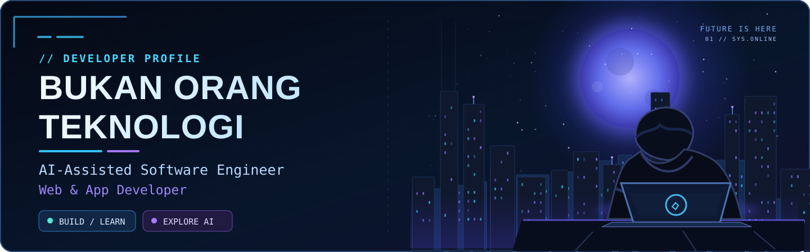

<table width="100%">
<tr>
<td bgcolor="#0D1117" align="center">

 

<h3>
  <code>AI-Assisted Software Engineer · Web & App Developer</code>
</h3>

<em>Build. Learn. Improve. Repeat.</em>

  
  <strong>Indonesia</strong>

 

</td>
</tr>
</table>

<table width="100%">
<tr>
<td bgcolor="#0D1117">

 

<h2 align="center">
  <code>About Me</code>
</h2>

 

I build practical software with a focus on <strong>web applications</strong>, <strong>backend systems</strong>, <strong>automation</strong>, and <strong>AI-assisted development workflows</strong>.

 

</td>
</tr>
</table>

<table width="100%">
<tr>
<td bgcolor="#0D1117" align="center">

 

<h2>
  <code>Tech Stack</code>
</h2>

  

  <strong>Go</strong> •
  <strong>Python</strong> •
  <strong>JavaScript</strong> •
  <strong>TypeScript</strong> •
  <strong>React</strong> •
  <strong>Node.js</strong> •
  <strong>PostgreSQL</strong> •
  <strong>Redis</strong> •
  <strong>Docker</strong> •
  <strong>Nginx</strong> •
  <strong>Linux</strong> •
  <strong>Git</strong>

 

</td>
</tr>
</table>

<table width="100%">
<tr>
<td bgcolor="#0D1117" align="center">

 

<h2>
  <code>GitHub Activity</code>
</h2>

  
  

  <a href="https://github.com/itsbukanorang?tab=overview">View full contribution calendar on GitHub</a>

 

</td>
</tr>
</table>

<table width="100%">
<tr>
<td bgcolor="#0D1117" align="center">

 

<strong>🇮🇩 Bukan Orang Teknologi</strong>

 
 

<em>Future Is Here.</em>

 
 

</td>
</tr>
</table>
